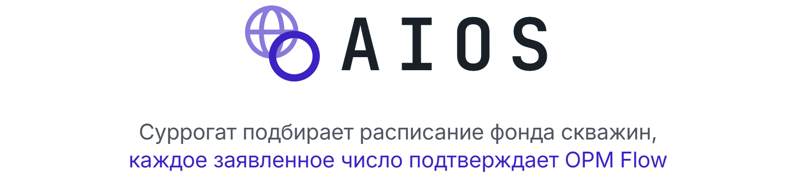
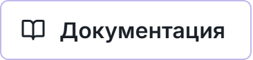
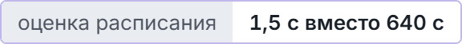
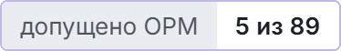
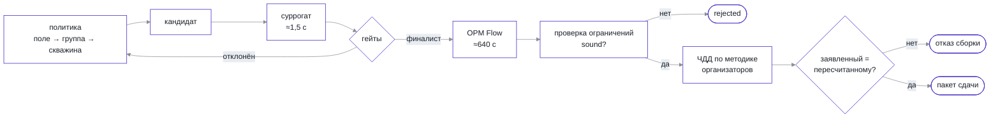

<p align="center">
  <picture>
    <source media="(prefers-color-scheme: dark)" srcset="docs/readme/banner.dark.png">
    
  </picture>
</p>

<p align="center">
  Мультиагентная система управления фондом скважин Model_Z. Быстрая модель перебирает расписания,
  настоящий симулятор OPM Flow проверяет финалистов, а пакет сдачи не соберётся, если их числа разошлись.
</p>

<p align="center">
  <!-- readme:buttons -->
  <a href="#запуск"><picture><source media="(prefers-color-scheme: dark)" srcset="docs/readme/cta-run.dark.png"></picture></a>
  <a href="docs/product.md"><picture><source media="(prefers-color-scheme: dark)" srcset="docs/readme/cta-product.dark.png"></picture></a>
  <a href="docs/README.md"><picture><source media="(prefers-color-scheme: dark)" srcset="docs/readme/cta-docs.dark.png"></picture></a>
  <!-- /readme:buttons -->
</p>

<p align="center">
  <!-- readme:status -->
  <a href="#результаты"><picture><source media="(prefers-color-scheme: dark)" srcset="docs/readme/badge-status-1.dark.png"></picture></a>
  <br>
  <a href="#зачем-это"><picture><source media="(prefers-color-scheme: dark)" srcset="docs/readme/badge-status-2.dark.png"></picture></a>
  <a href="#результаты"><picture><source media="(prefers-color-scheme: dark)" srcset="docs/readme/badge-status-3.dark.png"></picture></a>
  <a href="LICENSE"><picture><source media="(prefers-color-scheme: dark)" srcset="docs/readme/badge-status-4.dark.png"></picture></a>
  <!-- /readme:status -->
</p>

<p align="center">
  <!-- readme:stack -->
  <picture><source media="(prefers-color-scheme: dark)" srcset="docs/readme/badge-stack-1.dark.png"></picture>
  <picture><source media="(prefers-color-scheme: dark)" srcset="docs/readme/badge-stack-2.dark.png"></picture>
  <picture><source media="(prefers-color-scheme: dark)" srcset="docs/readme/badge-stack-3.dark.png"></picture>
  <br>
  <picture><source media="(prefers-color-scheme: dark)" srcset="docs/readme/badge-stack-4.dark.png"></picture>
  <picture><source media="(prefers-color-scheme: dark)" srcset="docs/readme/badge-stack-5.dark.png"></picture>
  <!-- /readme:stack -->
</p>

<p align="center">
  <!-- readme:nav -->
  <a href="#зачем-это"><picture><source media="(prefers-color-scheme: dark)" srcset="docs/readme/badge-nav-1.dark.png"></picture></a>
  <a href="#как-это-работает"><picture><source media="(prefers-color-scheme: dark)" srcset="docs/readme/badge-nav-2.dark.png"></picture></a>
  <a href="#попробовать-за-две-минуты"><picture><source media="(prefers-color-scheme: dark)" srcset="docs/readme/badge-nav-3.dark.png"></picture></a>
  <br>
  <a href="#результаты"><picture><source media="(prefers-color-scheme: dark)" srcset="docs/readme/badge-nav-4.dark.png"></picture></a>
  <a href="#запуск"><picture><source media="(prefers-color-scheme: dark)" srcset="docs/readme/badge-nav-5.dark.png"></picture></a>
  <a href="#устройство"><picture><source media="(prefers-color-scheme: dark)" srcset="docs/readme/badge-nav-6.dark.png"></picture></a>
  <a href="#ограничения"><picture><source media="(prefers-color-scheme: dark)" srcset="docs/readme/badge-nav-7.dark.png"></picture></a>
  <!-- /readme:nav -->
</p>

<p align="center">
  
  <br>
  <sub>Экран <code>/overview</code>: что происходило с фондом за все 225 управляющих шагов.</sub>
</p>

## Зачем это

Полный гидродинамический прогон Model_Z в OPM Flow занимает около 640 секунд. Быстрая модель
оценивает то же расписание примерно за 1,5 секунды, и только на этой скорости поиск может
перебрать десятки вариантов. Замеры лежат в
[`direct-head-control.json`](artifacts/surrogate-hybrid-ab-20260910/direct-head-control.json)
(`verification_seconds`) и [`retrospective-audit.json`](artifacts/surrogate-screen-20260910/retrospective-audit.json)
(`inference_seconds`).

Быстрая модель уверенно ошибается там, где это опаснее всего. В том же аудите есть строка
с `inside_domain: false`: предсказанный ЧДД −18 668 131 086 ₽ при измеренном 1 464 123 030 ₽.

Поэтому в проекте одно правило: ни одно число не произносится со слов суррогата. Суррогат
отбирает кандидатов, каждый финалист заново считается в OPM Flow, проверяется на ограничениях,
и его ЧДД пересчитывается по методике организаторов на отклике симулятора.

## Как это работает

Поиск идёт тысячами итераций на суррогате, подтверждение — единицами запусков OPM.



Три решения держат это правило в коде:

- **Прогноз — не результат.** В прогоне два разных поля: `predicted_npv` от суррогата и
  `verified_npv` от OPM. Заявляется только второе; консоль показывает разницу в колонке
  «Происхождение».
- **Сходимость OPM — не допуск.** `sound=true` требует больше, чем успешное завершение Flow:
  диагностический прогон `jarvis-policy-20260926` закончился OPM `OK` и получил `sound=false`
  из-за 165 нарушений водного баланса.
- **Вне обученной области до OPM не доходит.** Порог применимости по умолчанию
  `CONSERVATIVE_OOD_THRESHOLD = 0.0`
  ([`ood_calibration.py`](backend/contexts/optimization/infrastructure/ood_calibration.py)):
  любой узел за границами обучающего диапазона отклоняет кандидата.

Статус `ready_to_submit` ставит только `aios run submit`, после того как пакет собран и
круговая проверка сошлась ([`workflow.py`](backend/contexts/runs/application/workflow.py)).

Решение принимают уровни агентов: поле балансирует закачку и отбор, группа распределяет квоты,
скважина выбирает режим. Каждое решение попадает в след
([`trace.py`](backend/contexts/policy/domain/trace.py)), поэтому видно, почему выбран режим,
или что причина не записана.

<p align="center">
  
  <br>
  <sub>Экран <code>/money/comparison</code>: проверенное и предсказанное разделены построчно.</sub>
</p>

## Попробовать за две минуты

Консоль работает на витрине, которая лежит в git, поэтому для этого маршрута не нужен
ни один прогон OPM. Поднимите её по разделу [Запуск](#запуск) и откройте
<http://localhost:8000>.

| Шаг | Открыть | Что видно |
|---|---|---|
| 1 | `/overview` | Накопленный ЧДД, компенсация, отбор, закачка и обводнённость за 225 шагов |
| 2 | `/field/projection` | Измеренный граф связности λ между 103 скважинами |
| 3 | `/field/maps` | Карты дека Model_Z по двум пластам, k 1–26 и k 29–53 |
| 4 | `/money/comparison` | Происхождение каждого числа построчно, чемпион отмечен |
| 5 | Сфера Джарвиса | Вопрос словами, ответ сценой из карточек с происхождением каждого числа |

<p align="center">
  
</p>

## Результаты

Каждое число прослеживается до файла в репозитории. Полный список утверждений с градацией
«измерено, проверено, принято на веру» — на [странице доказательств](docs/evidence.md).

| Величина | Что показывает | Источник |
|---|---|---|
| Чемпион 2 754 126 065,49 ₽ против базы 1 464 123 030,44 ₽ | Оба числа от OPM, на одних хешах кейса, дека и методики | [`evaluations.json`](artifacts/final-readiness-20260909/evaluations.json), `candidate-008` и `candidate-005` |
| Холодный повтор дал тот же ЧДД бит в бит, `sound: true` | Результат воспроизводится из чистого клона | [`result.json`](artifacts/final-readiness-20260909/cold-repeat/candidate-005/economics/result.json) |
| 5 из 89 кандидатов получили `sound=true` | Допуск — редкое событие, а не формальность | [`evaluations.json`](artifacts/final-readiness-20260909/evaluations.json) |
| ≈1,5 с против ≈640 с на одно расписание | Во столько раз поиск дешевле проверки | [`artifacts/`](artifacts/) |
| 13 контекстов, списки исключений пусты | Границы слоёв проверяет тест | [`test_context_boundaries.py`](tests/architecture/backend/test_context_boundaries.py) |

Поле: 103 скважины, 2 пласта, горизонт с 01.01.2007, 224 интервала управления
([`horizon-model-z.json`](config/horizon-model-z.json)). Как воспроизвести —
[verification.md](docs/verification.md).

## Запуск

Нужны Python 3.11+ и Node.js для сборки интерфейса.

```bash
python3 -m venv .venv
.venv/bin/pip install -e '.[dev,ml]'
(cd frontend && npm ci && npm run build)
aios selfcheck
aios web
```

`aios selfcheck` печатает, что нашлось на машине: данные организаторов, дек, эталонный
расчётчик, нормативы, собранный фронт, Docker, `numpy` и `torch`. По выводу видно, какие
команды запустятся. `aios web` поднимает консоль на <http://localhost:8000>.

Расчётная цепочка требует данных организаторов и весов суррогата, которых в git нет:

```bash
aios run search --run-id <id>
aios run verify --run-id <id>
aios run submit --run-id <id>
```

Консоль вместе с Джарвисом в Docker:

```bash
docker compose --env-file .env.local up --build jarvis web
```

Переменные окружения, группы команд и типовые отказы — в [руководстве по запуску](docs/running.md).

> **Windows.** Вывод русскоязычный, консоль по умолчанию в cp1252, и команды падают с
> `UnicodeEncodeError`. Ставьте `PYTHONIOENCODING=utf-8`; интерпретатор —
> `.venv/Scripts/python.exe`.

## Устройство

```text
backend/     13 контекстов: домен, сценарии, инфраструктура, интерфейсы CLI и HTTP
frontend/    консоль на React и TypeScript, витрина данных в public/data
config/      кейс, ограничения, горизонт, калибровки
artifacts/   записанные прогоны и замеры, на которые ссылаются числа
tests/       архитектурные сторожа, контексты, золотые снимки
tools/       разовые замеры: компенсация, λ, калибровка OOD
```

| Документ | О чём |
|---|---|
| [Продукт](docs/product.md) | Задача, подход, что показано и что за границей |
| [Архитектура](docs/architecture.md) | Контексты, правила слоёв и шесть схем, снятых с кода |
| [Суррогат](docs/surrogate.md) | Из чего состоит модель, как обучена и где её область применимости |
| [Джарвис](docs/jarvis.md) | Ассистент консоли: инструменты, карточки, сторож чисел |
| [Проверка](docs/verification.md) | Холодный повтор, круговая проверка пакета, архитектурные тесты |
| [Формат кейса](config/README.md) | Лимиты, простои, водный баланс, BHP и источник каждого параметра |

<p align="center">
  
  <br>
  <sub>Джарвис объясняет план и результаты карточками из записанных артефактов. Он не управляет скважинами и не считает заявляемый ЧДД.</sub>
</p>

## Ограничения

- **Нейросеть в суррогате отвечает не за деньги.** Ансамбль из трёх сетей предсказывает
  траектории по скважинам, скалярный ЧДД даёт отдельная голова на ядерной гребневой регрессии
  ([`economics_prediction.py`](backend/contexts/optimization/application/economics_prediction.py)).
  Полный граф λ в сеть не подаётся.
- **Заголовочные метрики качества суррогата не подтверждены данными репозитория.** Единственный
  метрический артефакт сообщает попарную точность 0,667 на шести прогонах и сам помечен как
  диагностика.
- **ЧДД сравнимы только при одинаковых условиях.** Кейс, период, дек, нормативы и методика
  должны совпадать, поэтому в прогоне и пакете сохранены хеши.
- **Коридор компенсации 0,85–1,15 назначен нами, а не организаторами.** В
  [`competition-constraints.json`](config/competition-constraints.json) он помечен
  `diagnostic`.
- **Исторические метрики не переносятся на новое месторождение.** OOD-фильтр отклоняет
  неподтверждённые режимы, но не делает прогноз на них точным.
- **Джарвису нужен внешний LLM-шлюз.** Без ключа он отвечает явной ошибкой, расчётная часть
  консоли от него не зависит.
- **Свежий клон неполон.** Веса, датасеты и данные организаторов в git не хранятся; консоль и
  Джарвис работают на витрине, новые расчёты — нет.

Каждая граница целиком — в [limitations.md](docs/limitations.md).

<p align="center">
  <picture><source media="(prefers-color-scheme: dark)" srcset="docs/readme/mark.dark.png"></picture>
  <br>
  <sub>Команда Ullax, хакатон AIOS от Blue Sky Research, трек «Масштабируемая мультиагентная система», 2026. Лицензия <a href="LICENSE">MIT</a>.</sub>
</p>
